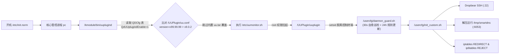
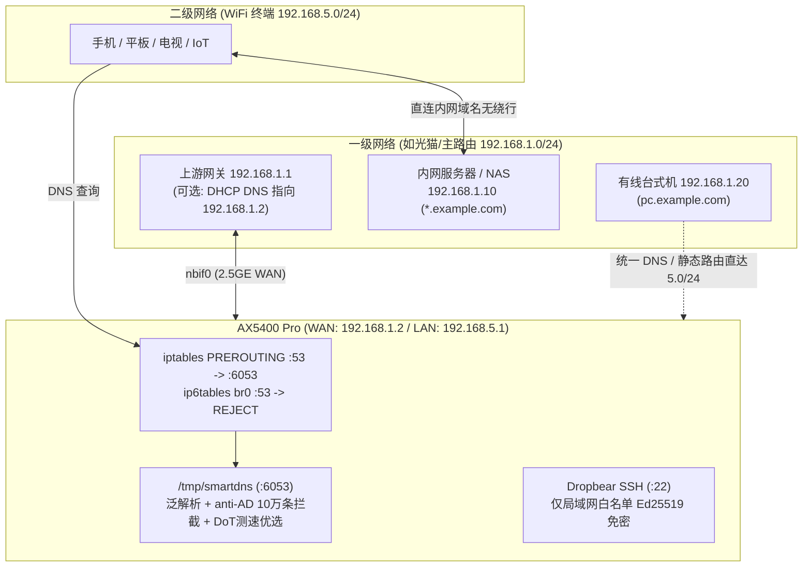

# 中兴 AX5400 Pro (ZXHN E3630) 免拆机解锁 SSH + 原生冷启动固化 + SmartDNS 泛解析与去广告方案

[](LICENSE)
[-0072CE)](https://www.ztedevices.com/)
[](#1-适用设备与硬件概况)

本项目提供一套针对 **中兴 AX5400 Pro（内部型号 `ZXHN E3630`）** 的**免拆机、不刷改只读固件分区、零磨损 NAND 闪存**的完整 Root 运维与家庭网络增强方案。

在官方新固件（如 `V1.0.0.10B5.0000`）已封堵传统 `webFac` 工厂接口、且精简版原厂 `dnsmasq` 阉割了泛域名解析语法的背景下，本方案通过逆向 **Type-4 配置文件加解密算法** 与 **`uuplugind` 原生守护进程机制**，实现了断电重启 100% 自动恢复的 **Dropbear SSH 免密登录 + SmartDNS 真·泛域名解析 + 10 万条 anti-AD 自动去广告 + 二级路由跨网段无损互通**。

---

## ✨ 核心特性

- 🔓 **免拆机解锁永久 Telnet Root & 阻断自动升级**：完整实现 E3630 `Type-4` 配置文件（外层 `AES-256-CBC` + 内层分块 `zlib` 双重 CRC32 校验）加解密，一键注入局域网 Telnet Root 并关闭官方夜间 OTA 自动升级（`UpgradeCtrl=0`）。
- 🔑 **纯公钥免密 Dropbear SSH**：静态交叉编译 `<1MB` 的 `dropbearmulti`（仅允许 `Ed25519` 公钥认证、挂载私有 `devpts`、防火墙白名单严格封禁 WAN 与公网 IPv6 访问 22 端口）。
- ⚡ **原生断电冷启动自启（不动只读 SquashFS）**：利用固件内置 `pc` $\rightarrow$ `uuplugind` 守护链与 `QDCfg` 配置开关，锁定 `/UUPlugin/uu.conf` 版本号为 `v99.99.99` 绕过原厂解包覆盖，实现断电冷启动自动拉起全套服务。
- 🌐 **SmartDNS 真·泛域名解析 + 自动去广告**：
  - 突破原厂 84KB 残血 `dnsmasq` 无法配置 `address=/domain/ip` 的限制；
  - 支持内网泛域名兜底（如 `*.example.com` 指向 NAS）+ 最长精确匹配优先（如 `pc.example.com` 指向台式机）+ `#6` 秒回 IPv6 SOA 防内网域名公网泄漏；
  - 每日自动拉取最新 [anti-AD](https://anti-ad.net/) 规则（~10 万条广告与隐私追踪域名拦截）。
- 🛡️ **双分区压缩冗余 + 内存盘零磨损运行**：将 `5MB` 的静态 SmartDNS 压缩为 `2MB` 的 `smartdns.gz` 冗余存放于空闲 JFFS2 分区（`/UUPlugin` 与 `/status`），开机解压至内存盘 `/tmp` 运行，广告规则与日志全部位于 `tmpfs`，**日常对 NAND Flash 零写入磨损**。
- 📵 **封堵手机 IPv6 DNS 绕过**：针对移动端优先请求 IPv6 DNS 导致泛解析失效与广告漏网的痛点，在 `ip6tables` 对局域网 53 端口执行毫秒级 `REJECT`，迫使终端 `<0.1ms` 无感回退至 IPv4 SmartDNS（仍正常返回 `AAAA` 记录，丝毫不影响 IPv6 上网）。
- 🔀 **二级路由跨网段免绕行互通（可选）**：保持二级路由模式 100% 稳定性（规避部分固件 AP 模式偶发断流），打通一级有线网（如 `192.168.1.0/24`）与二级 WiFi 网（如 `192.168.5.0/24`）双向直连。

---

## 1. 适用设备与硬件概况

| 项目 | 实测规格 |
| :--- | :--- |
| **产品名称 / 内部型号** | 中兴 AX5400 Pro / **ZXHN E3630** |
| **实测固件版本** | `V1.0.0.10B5.0000` |
| **SoC / 架构** | 中兴自研 `ZX279128S`（四核 Cortex-A53 @ 1.1GHz，`aarch64` 兼容 32/64 位，Linux `4.1.25`） |
| **运行内存 (RAM)** | 可用约 `328 MB`（无 Swap；部署本方案全套组件后空闲内存仍余 `~78 MB`） |
| **闪存 (NAND Flash)** | `128 MB`，共 16 个 MTD 分区（`/` 为只读 SquashFS） |
| **可写持久化 JFFS2 分区** | `/usercfg` (`mtd4`, **2MB**)、`/UUPlugin` (`mtd9`, **5MB**)、`/status` (`mtd12`, **5MB**) |

---

## 2. 系统架构与冷启动原理

### 2.1 原生断电冷启动守护链

AX5400 Pro 的根文件系统 `/` 为只读 SquashFS，`/etc/init.norm` 不会执行 `/usercfg` 下的自定义脚本。通过对固件 `/kmodule/bin/uuplugind` 逆向分析，本方案构建了如下**零固件修改**的冷启动链路：



### 2.2 全屋 DNS 透明接管与双路由互通拓扑



---

## 3. 目录结构说明

```text
zte-ax5400pro-ssh-smartdns/
├── scripts/
│   ├── router_api.py             # Web API 登录、会话抢占与加密配置导出工具
│   ├── type4_config_tool.py      # Type-4 配置解密/加密、一键注入 Telnet Root & 禁升级工具
│   ├── telnet_client.py          # 零第三方依赖的 Telnet Root 命令执行客户端
│   ├── mtd_backup_receiver.py    # 全闪存分区 HTTP PUT 流式备份接收端 (自动生成 MD5)
│   └── build_dropbear_aarch64.sh # Docker 一键静态交叉编译适配 E3630 的 Dropbear SSH
├── router_files/
│   ├── uu.conf                   # 部署至 /UUPlugin/uu.conf (v99.99.99 防原厂覆盖)
│   ├── uuplugin                  # 部署至 /UUPlugin/uuplugin (原生冷启动入口)
│   ├── daemon_guard.sh           # 部署至 /usercfg/daemon_guard.sh (30秒巡检 + 24小时更新广告规则)
│   ├── init_custom.sh            # 部署至 /usercfg/init_custom.sh (SSH/转发/SmartDNS/防火墙幂等拉起)
│   ├── update_adblock.sh         # 部署至 /usercfg/update_adblock.sh (拉取 anti-AD 并重启 SmartDNS)
│   ├── smartdns.conf.example     # 部署至 /usercfg/smartdns.conf (泛解析与上游优选配置模板)
│   └── local-ssh/
│       ├── lan.conf.example      # 部署至 /usercfg/local-ssh/lan.conf (监听网段与双路由互通配置)
│       └── start.sh              # 部署至 /usercfg/local-ssh/start.sh (私有 devpts 挂载与白名单启动)
├── requirements.txt              # Python 依赖 (requests, pycryptodome)
└── LICENSE
```

---

## 4. 快速开始：分步完整部署指南

### 环境准备

在电脑上安装 Python 3.9+ 依赖：

```bash
pip install -r requirements.txt
```

---

### 第一步：导出配置并一键解锁永久 Telnet + 关闭自动升级

> ⚠️ **注意**：路由器 Web 后台仅允许单管理员会话在线。执行脚本前请**先关闭浏览器中的路由器管理页与手机中兴智慧生活 App**。

1. **导出当前加密配置文件 `config.bin`**（也可直接在路由器网页后台「系统 $\rightarrow$ 备份与恢复 $\rightarrow$ 备份配置」下载）：

```bash
python scripts/router_api.py export -H 192.168.5.1 -p "你的路由器管理密码" -o config.bin
```

2. **一键注入局域网 Telnet Root、关闭夜间自动 OTA 升级，并开启 `QdUUplugindEnable` 原生自启开关**：

```bash
python scripts/type4_config_tool.py patch-telnet config.bin patched_config.bin \
    --user root \
    --password "设置一个高强度Telnet密码" \
    --enable-autostart
```

3. **刷入修改后的配置**：
   打开浏览器登录路由器后台（`http://192.168.5.1`）$\rightarrow$ **「系统 $\rightarrow$ 备份与恢复」** $\rightarrow$ 上传 `patched_config.bin` 恢复配置。路由器将在约 1~2 分钟后重启完成。

4. **验证 Telnet Root 登录**：

```bash
python scripts/telnet_client.py -H 192.168.5.1 -p "刚才设置的Telnet密码" "uname -a" "id"
```

---

### 第二步：全量备份 15 个 MTD 闪存分区（强烈建议！）

在进行任何深度定制前，务必先将全部分区（含 Bootloader、参数区 `mtd2/mtd3`、双内核等）完整备份到电脑并校验 MD5：

1. **在电脑端启动 HTTP PUT 接收服务**（假设电脑局域网 IP 为 `192.168.5.100`）：

```bash
python scripts/mtd_backup_receiver.py --port 18080 --out-dir ./mtd_backup
```

2. **在路由器 Telnet 中流式上传全部分区并打印远端 MD5**：
   > ⚠️ **避坑**：切勿直接 `curl -T /dev/mtdblockN`（对块设备直接上传会发送 0 字节），**必须使用 `cat | curl -T -` 管道**！

```sh
for i in 0 1 2 3 4 5 6 7 8 9 10 11 12 13 14; do
    md5sum /dev/mtdblock$i
    cat /dev/mtdblock$i | curl -s -T - http://192.168.5.100:18080/mtd$i.bin
done
```

比对路由器输出的 `md5sum` 与电脑端 `./mtd_backup/MD5SUMS.txt` 完全一致后，妥善归档备份目录。

---

### 第三步：部署 Dropbear SSH 公钥免密登录

#### 为什么 SSH 登录用户名是 `Z500_w9bZ` 而不是 `root`？
查看固件只读的 `/etc/passwd` 可知：
```text
Z500_w9bZ:x:0:0:root:/root:/bin/sh
nobody:x:99:99:Nobody:/:/sbin/nologin
```
固件中唯一的 **`uid=0` 超级用户名为 `Z500_w9bZ`**（没有名为 `root` 的条目），且 `/root` 位于只读 SquashFS 无法写入 `.ssh/authorized_keys`。因此我们使用带 `-D /usercfg/local-ssh` 参数的静态版 Dropbear。

1. **编译静态二进制 `dropbearmulti`**（需安装 Docker）：

```bash
bash scripts/build_dropbear_aarch64.sh
# 产物位于 ./build_out/dropbearmulti (~990KB)
```

2. **在电脑上开启临时文件下载服务**（例如 `python -m http.server 8000`），通过 Telnet 将 `dropbearmulti`、`router_files/local-ssh/start.sh`、`lan.conf` 下载到路由器 `/usercfg/local-ssh/`：

```sh
mkdir -p /usercfg/local-ssh
cd /usercfg/local-ssh

# 下载编译好的 dropbearmulti 与脚本 (将 192.168.5.100 换为本机 IP)
curl -s http://192.168.5.100:8000/build_out/dropbearmulti -o dropbearmulti
chmod 755 dropbearmulti
ln -sf dropbearmulti dropbear
ln -sf dropbearmulti dropbearkey

curl -s http://192.168.5.100:8000/router_files/local-ssh/start.sh -o start.sh
curl -s http://192.168.5.100:8000/router_files/local-ssh/lan.conf.example -o lan.conf
chmod 755 start.sh

# 生成路由器主机密钥 (仅首次执行)
./dropbearkey -t ed25519 -f /usercfg/local-ssh/host_ed25519
chmod 600 /usercfg/local-ssh/host_ed25519

# 写入你电脑的 ~/.ssh/id_ed25519.pub 公钥内容
cat > /usercfg/local-ssh/authorized_keys <<'EOF'
ssh-ed25519 <粘贴你自己的 id_ed25519.pub 公钥字符串> user@pc
EOF
chmod 600 /usercfg/local-ssh/authorized_keys

# 启动 Dropbear SSH
setsid /usercfg/local-ssh/start.sh >/dev/null 2>&1 &
```

3. **在电脑 `~/.ssh/config` 添加别名实现免密秒连**：

```sshconfig
Host e3630
    HostName 192.168.5.1
    User Z500_w9bZ
    IdentityFile ~/.ssh/id_ed25519
```

现在即可在终端直接执行：
```bash
# 单条命令或脚本执行（毫秒级响应）
ssh e3630 "uname -a; df -k /usercfg /UUPlugin /status"

# 交互式 Shell（规避中兴定制内核 PTY TIOCSCTTY 限制，使用 -T 模式）
ssh -T e3630 "sh -i"
```

---

### 第四步：部署 SmartDNS（泛域名解析 + anti-AD 自动去广告）

1. **准备静态编译版 `smartdns-aarch64`**：
   从 [pymumu/smartdns Releases](https://github.com/pymumu/smartdns/releases) 下载官方静态二进制 `smartdns.<version>-aarch64-linux-all.tar.gz`，提取其中的 `smartdns` 可执行文件并压缩为 `smartdns.gz`（约 `2.0MB`）：

```bash
gzip -9 -c smartdns > smartdns.gz
```

2. **上传至双空闲闪存分区冗余存储**（绝不占用 `/usercfg` 宝贵空间）：

```bash
# 通过 HTTP 或管道经 SSH 上传至 /UUPlugin 与 /status 双备份
cat smartdns.gz | ssh e3630 "cat > /UUPlugin/smartdns.gz && cp /UUPlugin/smartdns.gz /status/smartdns.gz"
```

3. **自定义并上传 `smartdns.conf` 与守护脚本**：
   复制 `router_files/smartdns.conf.example` 为本地 `my_smartdns.conf`，将其中的 `example.com` 和内网 IP 修改为你自己的域名与服务器地址，然后上传全套脚本：

```bash
cat my_smartdns.conf | ssh e3630 "cat > /usercfg/smartdns.conf"
cat router_files/init_custom.sh | ssh e3630 "cat > /usercfg/init_custom.sh && chmod 755 /usercfg/init_custom.sh"
cat router_files/update_adblock.sh | ssh e3630 "cat > /usercfg/update_adblock.sh && chmod 755 /usercfg/update_adblock.sh"
cat router_files/daemon_guard.sh | ssh e3630 "cat > /usercfg/daemon_guard.sh && chmod 755 /usercfg/daemon_guard.sh"
```

> 💡 **Windows PowerShell 用户注意**：Windows PowerShell 5.1 的字符串管道可能自动插入 UTF-8 BOM (`\xef\xbb\xbf`) 导致 `#!/bin/sh` 无法识别。在 Windows 下推荐使用 `cmd /c "type router_files\init_custom.sh | ssh e3630 \"cat > /usercfg/init_custom.sh\""` 或 `scp` 上传。

---

### 第五步：激活 `UUPlugin` 原生断电冷启动自启

1. **部署 `/UUPlugin/uu.conf` 与 `/UUPlugin/uuplugin`**：

```bash
cat router_files/uu.conf | ssh e3630 "cat > /UUPlugin/uu.conf"
cat router_files/uuplugin | ssh e3630 "cat > /UUPlugin/uuplugin && chmod 755 /UUPlugin/uuplugin"
```

2. **确认配置库 `QDCfg` 自启标志已置为 `1`**（若第一步使用了 `--enable-autostart` 则已开启，也可在线直接确认并保存）：

```bash
ssh e3630 "sendcmd 1 DB set QDCfg 0 QdUUplugindEnable 1 && sendcmd 1 DB save && sendcmd 1 DB p QDCfg"
```

3. **在线免重启验证冷启动链路**（模拟 `pc` 重新拉起 `uuplugind`）：

```bash
ssh e3630 'rm -f /var/run/uu_autostart.ts; sendcmd -pc kill $(ps | grep "[u]uplugind" | awk "{print \$1}"); sleep 4; cat /var/run/uu_autostart.ts; ps | grep -E "smartdns|dropbear|daemon_guard"'
```

看到输出最新时间戳且 `dropbear`、`smartdns`、`daemon_guard.sh` 均正常运行，即代表**断电冷启动 100% 闭环**！

---

## 5. 进阶场景：二级路由跨网段无损互通（不改 AP 模式）

许多家庭采用「光猫拨号（`192.168.1.0/24`，接有线台式机与 NAS）+ 客厅 AX5400 Pro 二级路由（`192.168.5.0/24`，覆盖全屋 WiFi）」的架构。若不想改为 AP 模式（保持独立路由稳定性），按以下三步即可实现两个网段双向直通与全屋共享 SmartDNS：

1. **固定 AX5400 Pro 的 WAN 口 IP**：在路由器后台将 WAN 口设为静态 IP（例如 `192.168.1.2`，网关 `192.168.1.1`）。
2. **修改 `/usercfg/local-ssh/lan.conf`**：取消注释并填写上游私网参数：
   ```ini
   LAN_IP=192.168.5.1
   LAN_CIDR=192.168.5.0/24
   WAN_STATIC_IP=192.168.1.2
   UPSTREAM_LAN_CIDR=192.168.1.0/24
   ```
   执行 `/usercfg/init_custom.sh` 后，路由器会自动开启 `ip_forward=1`（中兴固件出厂默认为 `0`！）、放行 `192.168.1.0/24 -> 192.168.5.0/24` 转发并配置 `br0` 回包 `MASQUERADE`，同时在 `192.168.1.2:22` 开启局域网 SSH 监听。
3. **在一级网台式机添加一条永久静态路由**（经光猫交换芯片二层直达路由器，不绕行光猫 CPU）：
   ```cmd
   :: Windows 管理员终端执行
   route -p add 192.168.5.0 mask 255.255.255.0 192.168.1.2
   ```

---

## 6. 技术深挖：Type-4 配置文件格式规格

`ZXHN E3630` 导出的 `config.bin` 采用中兴 **Type-4** 加密容器格式，完整二进制结构如下：

1. **外层头（72 字节，大端序 `>II52sIII`）**：
   - `0x00..0x03`：魔数 `0x01020304`
   - `0x04..0x07`：容器类型 `4`（Type-4）
   - `0x08..0x3B`：52 字节全 `0x00` 保留区
   - `0x3C..0x3F`：内层未填充明文总长度 `plain_len`
   - `0x40..0x43`：16 字节对齐后的密文长度 `pad_len`
   - `0x44..0x47`：`0`
2. **AES-256-CBC 加密层**：
   - 型号内置派生常量（同型号通用）：
     - `KEY = SHA256("E3630Key18410001")`（32 字节）
     - `IV  = SHA256("E3630Iv18410001")[:16]`（16 字节）
   - 填充方式：末尾补 `0x00` 对齐至 16 字节整数倍。
3. **内层分块压缩容器（60 字节头 + 64KB 分块 `zlib` 流）**：
   - 前 24 字节 `>IIIIII`：魔数 `0x01020304`、`0`、解压后 XML 总字节数、最后一个分块在容器中的偏移量、分块阈值 `65536`、**所有压缩数据块（不含 12B 块头）的链式 `zlib.crc32`**；
   - 第 `24..27` 字节 `>I`：**前 24 字节头自身的 `zlib.crc32`**；
   - 第 `28..59` 字节：32 字节 `0x00`；
   - 第 `60` 字节起循环分块：每块由 `12` 字节头 `>III`（`解压长度`, `压缩长度`, `下一分块绝对偏移[末块为0]`）+ `zlib` 压缩流组成。

完整参考实现见 [`scripts/type4_config_tool.py`](scripts/type4_config_tool.py)。

---

## 7. 实战避坑铁律（必读）

1. **BusyBox 1.17.2 极度精简**：固件中**没有** `head`、`tail`、`strings`、`base64`、`netstat`，且 `ls` 不支持 `-h` 参数；取前 N 行请用 `sed Nq`，HTTPS 下载因无内置 CA 证书包必须使用 `curl -k`。
2. **Telnet 断开会发送 `SIGHUP`**：一切通过 Telnet 手动拉起的后台进程，**必须加 `setsid <cmd> >/dev/null 2>&1 &`**，否则退出 Telnet 瞬间进程会被连带杀死。
3. **严禁对 SmartDNS 发送 `SIGHUP`**：SmartDNS 未注册 `SIGHUP` 重载信号处理器，执行 `killall -HUP smartdns` 会**直接终止进程**！更新规则后必须 `killall smartdns` 并重新 `setsid` 启动。
4. **SmartDNS 必须同时声明 `bind` 与 `bind-tcp`**：在 `smartdns.conf` 中，`bind [::]:6053` 仅监听 UDP，必须额外写一行 `bind-tcp [::]:6053`，否则当 DNS 响应超过 512B 触发客户端 TCP 回退查询时会遭遇 `Connection refused`。
5. **本机开 Clash/Mihomo 代理时的注意事项**：客户端开启 TUN（Fake-IP 模式）时，外网域名会先被本机 TUN 网卡劫持返回 `198.18.x.x`；可将自己的内网泛域名后缀加入代理软件的 `fake-ip-filter` / 直连列表，即可本机与全屋手机/电视一致秒解内网域名。

---

## ⚠️ 免责与安全声明

1. 本仓库代码与文档仅供家庭网络技术研究、自有设备互操作性与 DNS 性能优化学习交流，严禁用于任何非法用途。
2. **安全红线**：`TelnetCfg` 中的 `Wan_Enable` 必须始终保持 `0`，Dropbear SSH 必须仅绑定局域网地址并配合 `iptables`/`ip6tables` 白名单，**切勿将路由器 22/23/80/6053 端口暴露于公网**。
3. 修改路由器闪存与配置存在一定风险，操作前请务必按本文档第二步完成全分区备份并核对 MD5。因不当操作导致的设备故障或保修失效由使用者自行承担。

## License

[MIT License](LICENSE)
